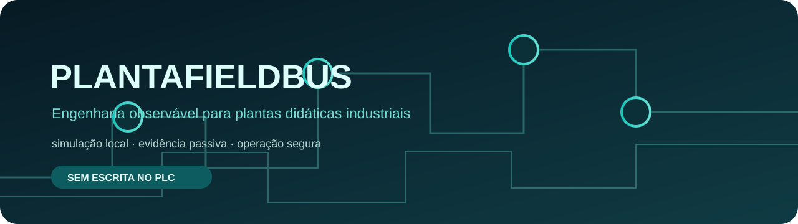
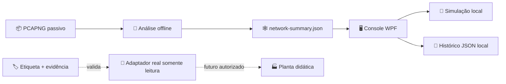

<div align="center">



<br><br>

# PlantaFieldbus

**Uma base aberta para observar, entender e operar uma planta didática com segurança.**<br>
Simulação local, evidência passiva de rede e uma interface independente para uma planta didática Fieldbus.

[](https://dotnet.microsoft.com/)
[](https://flutter.dev)
[](#-estado-atual)
[](#-limites-de-segurança)

[Visão geral](#-visão-geral) ·
[Recursos](#-recursos) ·
[Arquitetura](#-arquitetura) ·
[Como executar](#-como-executar) ·
[Captura passiva](#-captura-passiva) ·
[Segurança](#-limites-de-segurança)

</div>

---

## ✨ Visão geral

O **PlantaFieldbus** é uma base para construir uma interface independente de engenharia e operação de uma planta didática industrial. O projeto começa deliberadamente em **simulação local**: antes de qualquer integração física, a topologia e o protocolo precisam ser comprovados por etiqueta do equipamento e evidência passiva de rede.

O perfil de trabalho atual é uma planta didática com segmento FOUNDATION Fieldbus ainda sujeito à confirmação no laboratório.

## 🧭 Recursos

<table>
  <tr>
    <td align="center" width="33%">🖥️<br><b>Painel operacional</b><br><sub>Tags simuladas, métricas e sinótico de malha hidráulica</sub></td>
    <td align="center" width="33%">🧩<br><b>Designer de sinótico</b><br><sub>Prévia local de elementos demonstrativos, sem alteração em campo</sub></td>
    <td align="center" width="33%">📜<br><b>Histórico e alarmes</b><br><sub>Eventos do simulador guardados localmente no computador</sub></td>
  </tr>
  <tr>
    <td align="center">🕸️<br><b>Topologia offline</b><br><sub>Importa somente o resumo gerado de uma captura passiva</sub></td>
    <td align="center">🔌<br><b>Adaptadores isolados</b><br><sub>Contratos para simulação, OPC, Modbus TCP e HSE</sub></td>
    <td align="center">🛡️<br><b>Gates de segurança</b><br><sub>Sem descoberta ativa, escrita ou mudança de configuração</sub></td>
  </tr>
</table>

## 📊 Estado atual

| Área | Estado | Observação |
| --- | :---: | --- |
| Interface WPF para Windows | ✅ | Painel, sinótico, eventos e importação offline de topologia |
| Interface Flutter | ✅ | Protótipo preservado durante a migração para WPF |
| Simulador local | ✅ | Fonte de dados de desenvolvimento, somente leitura |
| Histórico de eventos | ✅ | Cache JSON local, sem envio de dados para rede |
| Importação de topologia | ✅ | Consome `network-summary.json` produzido pela análise offline |
| Controlador e IP reais | ✅ | DF51 / DFI302 confirmado em `192.168.164.100` por captura passiva, ARP e ICMP |
| Protocolo de leitura de processo | ⏳ | O anúncio UDP 4987 identifica o DF51, mas não confirma uma API de leitura |
| Comunicação com a planta | 🔒 | Intencionalmente desativada até validação do ambiente |

## 🧱 Arquitetura



| Pasta | Conteúdo |
| --- | --- |
| [`app/`](app/) | Console Flutter desktop, domínio, adaptadores e testes |
| [`docs/`](docs/) | Captura passiva, plano de automação, perfil Fieldbus e roadmap |
| [`desktop/PlantaFieldbus.Wpf/`](desktop/PlantaFieldbus.Wpf/) | Interface WPF nativa para Windows, em simulação local |
| [`scripts/`](scripts/) | Coleta e análise offline de evidências de rede |
| [`agents/`](agents/) | Papéis, máquinas de estado e gates para a investigação |

## 🚀 Como executar

### WPF para Windows

**Pré-requisito:** [.NET SDK 8](https://dotnet.microsoft.com/download/dotnet/8.0) para compilar; para executar o artefato publicado, basta o .NET Desktop Runtime 8.

```powershell
git clone https://github.com/frahncky/PlantaFieldbus.git
cd PlantaFieldbus
dotnet run --project .\desktop\PlantaFieldbus.Wpf\PlantaFieldbus.Wpf.csproj
```

Para gerar a distribuição local Windows x64:

```powershell
dotnet publish .\desktop\PlantaFieldbus.Wpf\PlantaFieldbus.Wpf.csproj -c Release -r win-x64 --self-contained false -o .\artifacts\windows-x64
```

> A aplicação WPF apenas simula dados e importa resumos JSON de capturas já realizadas. Ela não abre conexões de rede industrial.

### Protótipo Flutter

**Pré-requisitos:** [Flutter](https://docs.flutter.dev/get-started/install) com suporte a Windows desktop e o toolchain C++ do Visual Studio.

```powershell
git clone https://github.com/frahncky/PlantaFieldbus.git
cd PlantaFieldbus\app
flutter pub get
flutter analyze
flutter test
flutter run -d windows
```

> O aplicativo inicia em **simulação local**. Executá-lo não procura dispositivos, não se conecta à planta e não envia comandos.

<details>
<summary><b>Validação rápida</b></summary>

```powershell
cd app
flutter analyze lib test
flutter test
```

</details>

## 📡 Captura passiva

Quando o notebook estiver fisicamente conectado à bancada, siga [**captura-passiva.md**](docs/captura-passiva.md). O fluxo registra tráfego sem injetar pacotes e produz evidências para identificar, antes de qualquer cliente real:

- endereços e portas observados;
- protocolos e multicast presentes;
- papel provável de cada endpoint;
- variante e adaptador compatíveis.

O plano completo, os artefatos esperados e os gates estão em [**automation-plan.md**](docs/automation-plan.md). O estado das etapas do aplicativo está em [**software-roadmap.md**](docs/software-roadmap.md).

## 🔒 Limites de segurança

- **Não há descoberta ativa**, varredura, broadcast ou enumeração de hosts.
- **Não há conexão física automática** com controlador, bridge ou PLC.
- **Não há escrita, alteração de setpoint ou configuração de campo.**
- Um adaptador real só poderá ser habilitado após identificar o equipamento, validar o protocolo por evidência e obter autorização explícita no laboratório.
- O repositório não contém instaladores, binários, chaves de licença, projetos de terceiros, PCAPs ou dados de processo.

---

<div align="center">

<sub>Construído para aprender com a planta sem ultrapassar os limites dela.</sub>

</div>

